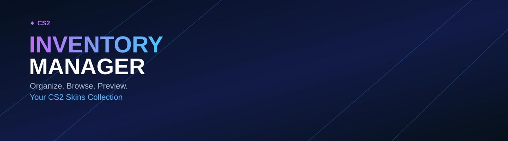
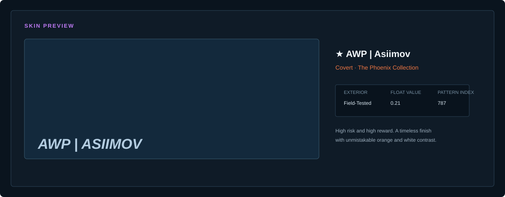
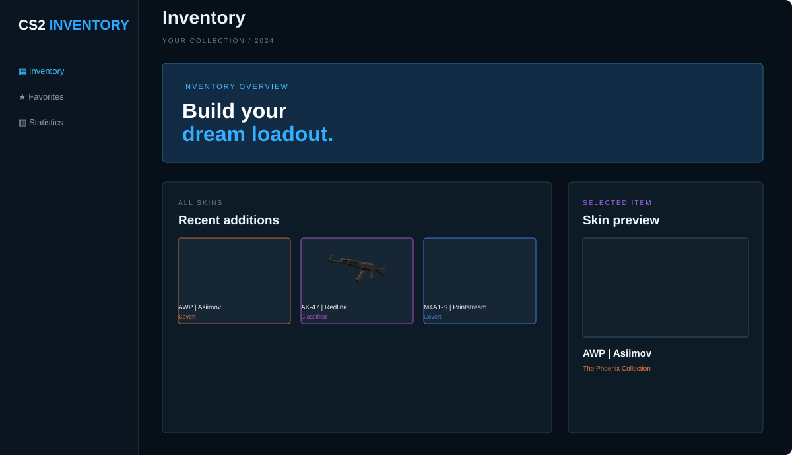
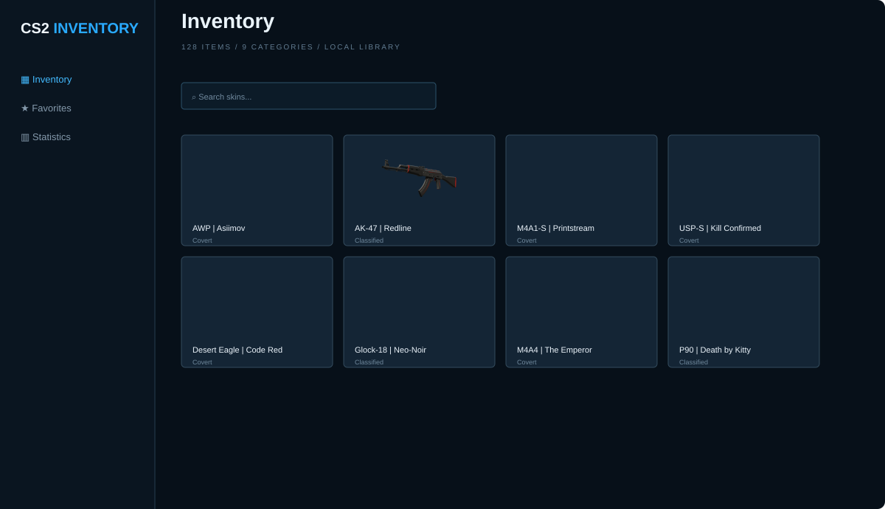

<div align="center">
  

  <p><strong>Organize. Browse. Preview.</strong><br />Your CS2 skins collection, presented as a clean desktop catalog.</p>

  <p>
    
    
    
    
  </p>
</div>

## About

CS2 Inventory Manager is a modern desktop-style catalog for viewing, organizing and previewing a Counter-Strike 2 skin collection. It focuses on fast browsing, useful metadata and a calm interface for collectors.

<table>
  <tr>
    <td width="50%" valign="top">
      <h3>🚀 Features</h3>
      <ul>
        <li><strong>Comprehensive catalog</strong><br />Browse skins with rarity, collection and weapon details.</li>
        <li><strong>Favorites</strong><br />Keep the skins you use most one click away.</li>
        <li><strong>Advanced filters</strong><br />Filter by weapon, rarity, collection and type.</li>
        <li><strong>Smart search</strong><br />Find any skin by name instantly.</li>
        <li><strong>Collection statistics</strong><br />Understand your collection with useful breakdowns.</li>
      </ul>
    </td>
    <td width="50%" valign="top">
      <h3>🎨 Skin preview</h3>
      <p>See the selected item with its exterior, float value, pattern index and finish style in one focused panel.</p>
      
    </td>
  </tr>
</table>

## Screenshots

<p align="center">
  
  
</p>

## Roadmap

- [x] Inventory and catalog
- [x] Favorites system
- [x] Search and filters
- [x] Skin preview
- [ ] Import and export collection data
- [ ] Optional price tracking as a separate integration
- [ ] Cloud sync
- [ ] Multi-account support

## Technologies

| Layer | Technology |
| --- | --- |
| Desktop UI | C++17 / Dear ImGui |
| Data | JSON skin database |
| Build | CMake |
| Platform | Windows, Linux and macOS targets |

## Disclaimer

This project is for educational and informational purposes only. It does not interact with game files, modify game files or provide unauthorized features. Use responsibly and respect the game developers.

## License

Distributed under the MIT License. See [`LICENSE`](LICENSE) for details.

## Project structure

```text
CS2-Inventory-Manager/
├── docs/
│   ├── assets/banner.svg
│   └── screenshots/
│       ├── dashboard.svg
│       ├── inventory.svg
│       └── preview.svg
├── assets/skins-database.json
├── index.html
├── styles.css
├── app.js
├── LICENSE
└── README.md
```
